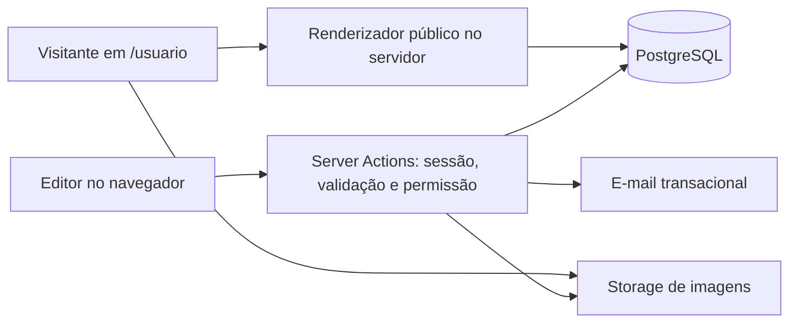

# Catlink — arquitetura do MVP

Status: arquitetura aprovada; integração de e-mail adiada pelo dono do produto. Implementação iniciada pelo cartão 04. Data: 07/11/2026.
Base aprovada: Next.js para frontend/backend, PostgreSQL e storage separado.

## Escopo aprovado

Público geral, interface em português, página de perfil e links fácil de personalizar.
Uma conta possui várias páginas: a primeira é gratuita; páginas adicionais exigem plano pago. O limite pago e o preço ainda serão definidos. Até existir cobrança, contas gratuitas não podem criar uma segunda página.
Blocos: texto, link, botão, imagem e redes sociais. Calendário, reservas e IA ficam fora desta entrega.
Métricas e detalhamento de privacidade foram adiados; não criar rastreamento no MVP. Isolamento entre contas continua obrigatório.
Referências visuais: HTMLs do repositório phsilvadev/Projetos; não tratá-los como requisitos funcionais automaticamente.

## Escolhas técnicas propostas

| Área                  | Escolha                                                    | Motivo                                                        |
| --------------------- | ---------------------------------------------------------- | ------------------------------------------------------------- |
| Aplicação             | Next.js App Router, React, TypeScript, Tailwind existentes | Um projeto para editor, servidor e página pública             |
| Persistência          | PostgreSQL com Prisma ORM e Prisma Migrate                 | Relações, transações e migrações versionadas                  |
| Autenticação          | Better Auth, sessões no banco, e-mail e senha              | Biblioteca pronta para sessão, verificação e recuperação      |
| Validação             | Zod no servidor                                            | Validar entrada e documento versionado dos blocos             |
| Aplicação hospedada   | Railway                                                    | Plataforma escolhida pelo dono do produto; serviço Next.js    |
| Banco                 | PostgreSQL no Railway, acessado pelo Prisma                | Banco separado do serviço Next.js, conexão privada em runtime |
| Imagens               | Bucket Railway compatível com S3                           | Storage separado do banco; acesso mediado pelo servidor       |
| E-mails transacionais | Integração adiada                                          | Provedor será escolhido em etapa posterior                    |

Prisma e Better Auth foram aprovados pelo dono do produto. Supabase foi descartado. Railway foi escolhido para aplicação e PostgreSQL. Bucket Railway compatível com S3 foi aprovado para imagens; Integração de e-mail adiada por decisão do dono do produto. Nenhum serviço Railway foi provisionado. Prisma, Better Auth e Zod já foram instalados para o cadastro/login; detalhes em AUTENTICACAO.md. Conferir compatibilidade com as versões reais do projeto durante o cartão 04. Não atualizar dependências apenas para seguir exemplos.

## Fluxo

O editor usa Client Components para interação. Acesso a dados, credenciais e regras ficam em módulos server-only. Route Handlers atendem autenticação e arquivos. Server Actions chamam serviços de domínio compartilhados; cada operação revalida sessão e propriedade, independentemente da proteção da página.
A prévia e a página pública usam o mesmo renderizador do documento, recebendo fontes diferentes: rascunho ou snapshot publicado.

## Modelo de dados

IDs UUID, datas UTC. Relações de propriedade são resolvidas pelo servidor.

| Entidade                             | Campos e relações essenciais                                                                          |
| ------------------------------------ | ----------------------------------------------------------------------------------------------------- |
| User, Session, Account, Verification | Schema exigido pela versão escolhida do Better Auth; User tem várias Page                             |
| Entitlement                          | userId único, plano FREE/PAID, pageLimit positivo e origem da concessão; sem cobrança no MVP          |
| Page                                 | id, ownerId, slug único normalizado, draftRevision, publishedVersionId opcional, createdAt, updatedAt |
| Profile                              | pageId único, displayName, bio, avatarAssetId, coverAssetId opcionais                                 |
| Block                                | id, pageId, type TEXT/LINK/BUTTON/IMAGE/SOCIAL, position, visible, data JSONB validado por tipo       |
| PageTheme                            | pageId único, themeKey, cores e tipografia dentro de opções permitidas                                |
| Asset                                | id, ownerId, storageKey único, mimeType, bytes, estado de validação                                   |
| PublishedVersion                     | id, pageId, sourceRevision, schemaVersion, document JSONB imutável, createdAt                         |

Redes sociais são um bloco SOCIAL com itens ordenados. Ordenação de blocos é atualizada numa transação. Snapshot contém perfil, tema e blocos visíveis; não contém e-mail, ownerId, sessão ou dados administrativos.
PublishedVersionId só pode apontar para uma versão da própria página, validado em serviço/transação e por relação composta quando suportada pelo schema.
Evento analítico é reservado para fase futura; não criar tabela, cookie ou coleta agora.

## Documento e limites iniciais de implementação

Documento versionado: schemaVersion = 1; perfil, tema e união discriminada de blocos. IDs estáveis por bloco. Texto é renderizado como texto, nunca HTML arbitrário.
Proposta inicial: até 100 blocos/página, nome até 80 caracteres, bio até 500, texto por bloco até 5.000 e título de link/botão até 120. URLs externas somente http/https; rejeitar javascript e data. Limites ajustáveis durante validação do editor.
Slug por página: 3–40 caracteres minúsculos, letras ASCII, números e hífen, sem hífen nas pontas. Unicidade global case-insensitive. Reservar app, api, admin, login, cadastro, recuperar-senha, configuracoes e caminhos internos. URL /usuario significa identificador da página, não identificador compartilhado por toda a conta.
Slug não muda após publicação no MVP, evitando quebrar links; mudança futura requer política de redirecionamento.

## Contratos mínimos

Operações autenticadas nunca aceitam ownerId/plano do cliente como fonte de autoridade.
Retorno comum: sucesso com dados, ou erro com código VALIDATION, UNAUTHENTICATED, NOT_FOUND, CONFLICT, PLAN_LIMIT ou INTERNAL; erros internos não expõem detalhes técnicos.

| Operação       | Entrada                             | Resultado e garantias                                                                                   |
| -------------- | ----------------------------------- | ------------------------------------------------------------------------------------------------------- |
| listPages      | sessão                              | Apenas páginas da conta                                                                                 |
| createPage     | slug e nome                         | Cria rascunho; bloqueio transacional na conta serializa contagem e limite; slug duplicado gera CONFLICT |
| getDraft       | pageId                              | Documento e revision; página alheia retorna NOT_FOUND                                                   |
| saveDraft      | pageId, expectedRevision, documento | Valida e salva perfil/tema/blocos numa transação; incrementa revision; conflito não sobrescreve edição  |
| publishPage    | pageId, expectedRevision            | Publica o rascunho salvo nessa revisão; snapshot e ponteiro publicados atomicamente                     |
| unpublishPage  | pageId                              | Remove ponteiro público; preserva rascunho e histórico; efeito idempotente                              |
| uploadImage    | arquivo e sessão                    | Valida tamanho, assinatura real e tipo JPEG/PNG/WebP, até 5 MB; retorna Asset da conta                  |
| readPublicPage | slug                                | Somente snapshot publicado; inexistente/despublicado retorna 404                                        |

Publicar exige primeiro salvar; a UI informa esse estado. Despublicação e publicação devem refletir imediatamente na próxima requisição: começar sem cache de conteúdo público; otimizar com invalidação explícita posteriormente.
Limite gratuito deve ser aplicado no servidor mesmo com requisições simultâneas. Planos pagos só liberam páginas mediante concessão confiável; implementar checkout e webhooks em tarefa posterior.
Upload passa pelo servidor com credencial restrita. Apenas imagens aprovadas podem ser públicas. Não apagar assets referenciados por rascunhos ou snapshots; limpeza é tarefa posterior. URLs conhecidas de imagens públicas continuam acessíveis após despublicação da página.
Autenticação precisa de cookies seguros, origens confiáveis, expiração, rate limit persistente para login/cadastro/recuperação e verificação de e-mail. Reutilizar recursos da biblioteca, sem implementar criptografia própria.

## Organização prevista

- app/(auth): cadastro, login, recuperação e verificação.
- app/app: painel e editor autenticados.
- app/[slug]: página pública.
- app/api/auth/[...all]: integração Better Auth.
- app/api/assets: upload validado.
- components/editor: componentes do editor, biblioteca e inspector.
- components/page: renderizador compartilhado.
- lib/server: auth, banco, storage e serviços de domínio.
- lib/schemas: validações compartilháveis sem credenciais.
- prisma: schema, migrações e seed de demonstração.

Estrutura de domínio planejada. As rotas /login, /cadastro, /app e /api/auth/[...all] já foram implementadas; os modelos de páginas e publicação continuam planejados.

## Ambientes, variáveis e migrações

Local, homologação e produção usam bancos, buckets e credenciais separados.
Para o bucket aprovado, variáveis de storage somente no servidor: S3_ENDPOINT, S3_REGION, S3_ACCESS_KEY_ID, S3_SECRET_ACCESS_KEY e S3_BUCKET. Confirmar o modo de entrega das imagens; não assumir bucket público. Sem dependência de Supabase. Variáveis exclusivamente do servidor: DATABASE_URL (runtime/pool), DIRECT_URL (migrações), BETTER_AUTH_SECRET, BETTER_AUTH_URL, variáveis de e-mail a definir em etapa posterior.
Não usar prefixo NEXT_PUBLIC em segredos. Valores reais entram no gerenciador de segredos do ambiente, nunca em Git ou chat. .env.example será criado no cartão 04.
Migrações geradas em desenvolvimento e versionadas; CI valida banco descartável. Aplicação de migrações em homologação/produção é etapa única controlada, antes do deploy compatível. Não executar migrate dev em produção.
Mudanças destrutivas exigem migração em etapas e backup restaurável. Documentar retenção de backup e ensaiar restauração antes do beta; verificar cobertura e custo do plano escolhido. Downgrade de plano não apaga páginas automaticamente; regra comercial será definida antes de disponibilizar planos pagos.

## Custos e revisão

Não há serviços contratados por este documento. Para desenvolvimento local, a aplicação e o banco podem rodar localmente; enviar e-mails e testar storage gerenciado depende da configuração escolhida.
Reserva de planejamento sugerida para um beta pequeno: US$ 50–100/mês para aplicação, banco, storage e e-mails, mais domínio e possíveis impostos. É orçamento preliminar, não cotação nem soma de preços verificados. Uso, tráfego, retenção de backups e condições comerciais podem mudar o valor.
Antes de provisionar: conferir preços oficiais, elegibilidade dos planos para SaaS comercial, região, limites, backup e egress; apresentar custo concreto ao dono do produto. Não assumir que planos gratuitos cobrem produção.

## Validação e sequência

Cartão 03 entrega esta especificação para revisão; não implementa login ou banco.
Próximo: 04 (padrões, lint, CI, README e .env.example); depois 05 (schema/migrações e isolamento), 06 (autenticação) e demais dependências do Trello.
Testes necessários na implementação: limite gratuito concorrente, isolamento entre dois usuários, slug duplicado/reservado, conflito de revisão, rascunho não público, publicação atômica, despublicação e upload inválido. Jornada do beta deve funcionar em celular.
Arquitetura aprovada; e-mail adiado. Custos devem ser validados antes de provisionar. Aplicação e PostgreSQL serão hospedados no Railway. Base Next.js + PostgreSQL + Prisma + Better Auth aprovada; Supabase descartado. Preço pago e provedor de cobrança ficam no F04.

## Decisão de hospedagem — 07/11/2026

Railway escolhido pelo dono do produto para hospedagem. Planejar serviço Next.js e PostgreSQL separados, com conexão privada em runtime e credencial de migração apropriada. Imagens não devem ficar no filesystem efêmero do serviço. Bucket Railway compatível com S3 foi aprovado como storage. Ainda não foram criados projeto, serviço, banco ou bucket. Confirmar backups, custos e configuração de e-mail antes da produção.

## E-mail adiado e início da implementação

O dono do produto adiou a integração de e-mail para iniciar o desenvolvimento. Não exigir credencial de envio para executar a interface e a fundação. Quando a autenticação for implementada, não apresentar recuperação/verificação por e-mail como funcionais sem transporte configurado. Revisar essa limitação antes de beta público. Cartão 04 implementa padrões e CI; o 05 implementará o banco.
